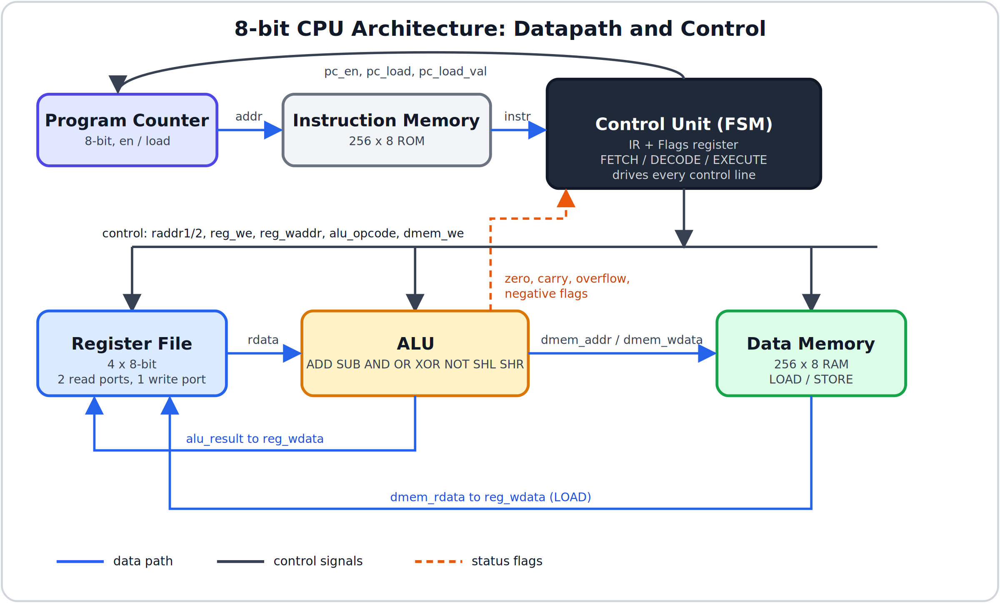
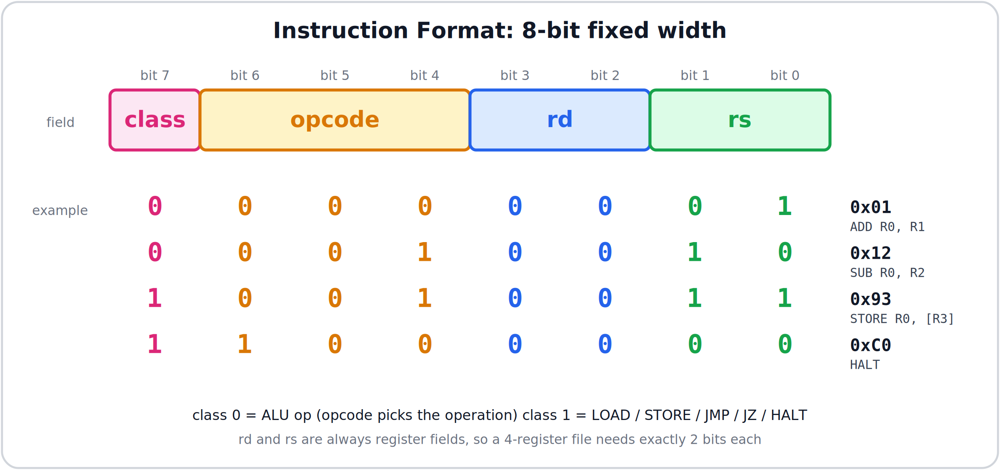
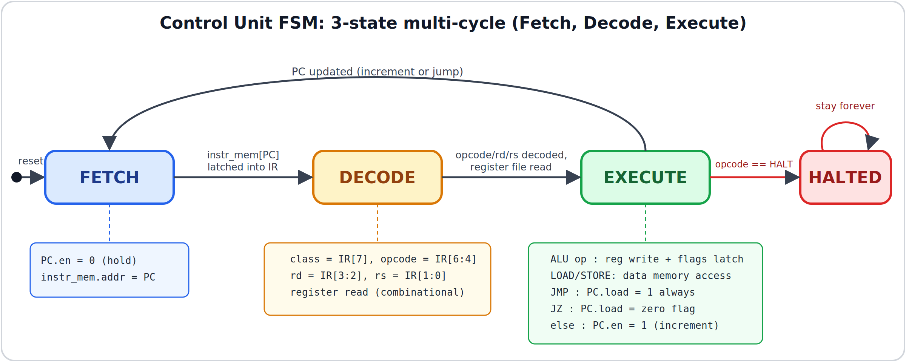
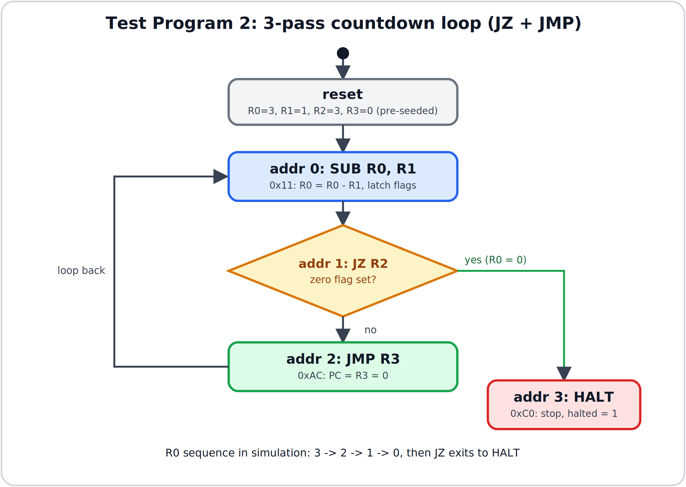
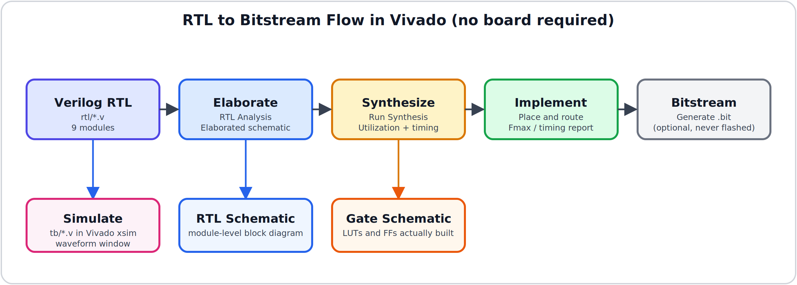

# 8-Bit CPU — Built From Scratch in Verilog

A fully custom 8-bit CPU designed, implemented, and verified from first principles — starting at a single D flip-flop and ending with a hand-assembled program running end-to-end through a real Fetch → Decode → Execute control unit, synthesized to a real FPGA bitstream.

No IP cores, no pre-built cores, no HLS. Every module — flip-flop, register, ALU, register file, program counter, instruction memory, data memory, and control unit — was designed, coded, and independently verified before being wired into the final `cpu_top`.

---

## Table of Contents
- [Highlights](#highlights)
- [Architecture](#architecture)
- [Instruction Set Architecture (ISA)](#instruction-set-architecture-isa)
- [Control Unit — FSM](#control-unit--fsm)
- [Module Overview](#module-overview)
- [Verification](#verification)
- [Synthesis (Vivado)](#synthesis-vivado)
- [Repository Structure](#repository-structure)
- [Getting Started](#getting-started)
- [Known Limitations / Roadmap](#known-limitations--roadmap)
- [Tools Used](#tools-used)

---

## Highlights

- **8-bit datapath**, 4-register register file, 3-cycle multi-cycle CPU
- **13-instruction ISA**: 8 ALU ops (ADD, SUB, AND, OR, XOR, NOT, SHL, SHR) + LOAD, STORE, JMP, JZ, HALT
- **Register-indirect addressing** — a deliberate, documented ISA trade-off (see [Known Limitations](#known-limitations--roadmap))
- Every module independently testbenched **before** integration
- 3 hand-assembled test programs verified end-to-end: straight-line ALU/STORE/HALT, a JZ/JMP countdown loop, and a STORE→LOAD memory round-trip
- Synthesizable top level with real observable outputs, taken through the Vivado flow (elaborate, synthesize, implement)

---

## Architecture



**Top-level ports (`cpu_top`):** `clk`, `reset` in; `halted_out`, `pc_out[7:0]`, plus observable ALU, register-file, data-memory, and PC-control outputs. Internally, the control unit is the only module with no data storage of its own — it purely reads the IR and flags, and drives every other module's control lines.

---

## Instruction Set Architecture (ISA)

8-bit fixed-width instructions. Bit 7 selects the instruction *class*; bits [3:2] and [1:0] are always register fields (`rd`, `rs`), regardless of instruction type.



| Class | Opcode | Mnemonic | Operation |
|:---:|:---:|:---|:---|
| 0 | 000 | ADD | `reg[rd] = reg[rd] + reg[rs]` |
| 0 | 001 | SUB | `reg[rd] = reg[rd] - reg[rs]` |
| 0 | 010 | AND | `reg[rd] = reg[rd] & reg[rs]` |
| 0 | 011 | OR  | `reg[rd] = reg[rd] \| reg[rs]` |
| 0 | 100 | XOR | `reg[rd] = reg[rd] ^ reg[rs]` |
| 0 | 101 | NOT | `reg[rd] = ~reg[rd]` (unary) |
| 0 | 110 | SHL | `reg[rd] = reg[rd] << 1` |
| 0 | 111 | SHR | `reg[rd] = reg[rd] >> 1` |
| 1 | 000 | LOAD  | `reg[rd] = MEM[reg[rs]]` |
| 1 | 001 | STORE | `MEM[reg[rs]] = reg[rd]` |
| 1 | 010 | JMP | `PC = reg[rd]` (unconditional) |
| 1 | 011 | JZ  | `PC = reg[rd]` if last ALU result was zero |
| 1 | 100 | HALT | stop execution, hold state permanently |

**Design note — register-indirect addressing:** LOAD/STORE/JMP/JZ don't carry a raw address in the instruction — there's no room left in 8 bits once opcode + 2 register fields are used. Instead they use a *register* that already holds the address. This is a deliberate v1 trade-off, not an oversight — see [Known Limitations](#known-limitations--roadmap).

---

## Control Unit — FSM

A 3-state, multi-cycle control unit (chosen over single-cycle for a faster clock and far easier per-stage debugging/observation):



Every instruction takes exactly 3 clock cycles: **Fetch → Decode → Execute**, then loops back to Fetch (unless HALT was just decoded, which freezes the FSM permanently). The control unit generates no new logic of its own — its entire job is asserting the correct combination of existing signals (`register_file.we`, `alu.opcode`, `dmem.we`, `pc.load`, etc.) at the right cycle, based on what's sitting in the IR.

---

## Module Overview

| Module | Role | Notes |
|---|---|---|
| `dff` | 1-bit D flip-flop | Foundation of every storage element in the design |
| `register` | Parameterized N-bit register | Built from `WIDTH` instances of `dff`, with `en`-gated self-feedback for "hold" |
| `alu` | 8-bit ALU | 8 operations, 4 status flags (zero, carry, overflow, negative) |
| `register_file` | 4 × 8-bit registers | 1 write port, 2 simultaneous combinational read ports, one-hot write decoding |
| `pc` | Program Counter | 8-bit register specialized with `load`/`load_val` for jumps, holds during Fetch/Decode |
| `instr_mem` | Instruction ROM | 256 × 8-bit, pre-loaded with the hand-assembled test program |
| `data_mem` | Data RAM | 256 × 8-bit, read/write, backs LOAD/STORE |
| `control_unit` | 3-state FSM | Decodes IR, drives every control signal in the CPU |
| `cpu_top` | Top-level integration | Pure structural wiring — no new logic, just connects every module above |

---

## Verification

Every module was verified in isolation with a self-checking testbench before integration — flip-flop → register → ALU → register file → PC → instruction memory → data memory → full `cpu_top`.

**Full-CPU test programs (all verified in GTKWave, matching hand-traced expected values):**

| # | Program | Exercises | Result |
|---|---|---|---|
| 1 | `ADD R0,R1 → SUB R0,R2 → STORE R0→[R3] → HALT` | Straight-line ALU + STORE + HALT | ✅ `halted` rises and stays high; memory/register values match hand trace exactly |
| 2 | 3-pass countdown loop: `SUB R0,R1 → JZ R2 → JMP R3 → HALT` | Conditional branching (JZ) + unconditional JMP | ✅ Loops exactly 3 times, zero flag correctly gates the exit, HALT reached only via JZ |
| 3 | `STORE R0→[R3] → LOAD R1←[R3] → HALT` | Full memory round-trip | ✅ Value written by STORE is read back correctly into a *different* register by LOAD |

**Program 2 flow (JZ + JMP countdown):**



---

## Synthesis (Vivado)

The design is synthesizable and is taken through the standard Vivado flow: simulate, elaborate, synthesize, implement. No board is required; utilization, timing, and schematics are all available without hardware.



`cpu_top` exposes the ALU result and flags, register-file write port, data-memory bus, instruction word, and PC control lines as top-level outputs, so synthesis keeps the full datapath instead of trimming it as unobservable logic. Simulation behavior is unchanged by these extra ports.

A production version would keep the logic alive through real functional I/O instead, such as a memory-mapped UART (see the roadmap below).

---

## Repository Structure

```
cpu-project/
├── rtl/
│   ├── dff.v
│   ├── register.v
│   ├── alu.v
│   ├── register_file.v
│   ├── pc.v
│   ├── instr_mem.v
│   ├── data_mem.v
│   ├── control_unit.v
│   └── cpu_top.v
├── tb/
│   ├── dff_tb.v
│   ├── register_tb.v
│   ├── alu_tb.v
│   ├── register_file_tb.v
│   ├── pc_tb.v
│   ├── instr_mem_tb.v
│   ├── data_mem_tb.v
│   └── cpu_top_tb.v
├── sim/            # .vcd waveform dumps
├── vivado/         # Vivado project files, utilization/timing reports, schematic screenshots
├── docs/
│   ├── isa_spec.md
│   └── diagrams/
└── README.md
```

---

## Getting Started

**Tools required** (all free): [Icarus Verilog](http://iverilog.icarus.com/), [GTKWave](https://gtkwave.sourceforge.net/), and [Xilinx Vivado](https://www.xilinx.com/support/download.html) (free WebPACK/Standard edition) for synthesis and schematics.

```bash
# Simulate any module (example: full CPU)
iverilog -o cpu_top_tb.vvp rtl/*.v tb/cpu_top_tb.v
vvp cpu_top_tb.vvp
gtkwave cpu_top_tb.vcd

# Vivado: create a project, add rtl/*.v as design sources and tb/*.v as simulation sources,
# then use Run Simulation, Open Elaborated Design (schematic), Run Synthesis, Run Implementation.
```

---

## Known Limitations / Roadmap

Documented honestly as v1 scope decisions, not oversights — each is a natural, additive next step because the ALU, register file, and control unit were kept as clean, separate modules:

- **No immediate/MOVI-LDI instruction** — v1 has no way to load a raw constant into a register from the instruction stream itself (no spare bits in an 8-bit instruction). v1 works around this by pre-seeding starting register values in the testbench, similar to a hardware reset vector. **v2 fix:** variable-length (2-byte) instruction for immediates, or a shrunk 4-bit immediate field.
- **Pipelining** — currently a strict 3-cycle multi-cycle design; splitting Fetch/Decode/Execute into overlapping pipeline stages is the natural next step toward a "real" CPU architecture.
- **Memory-mapped I/O** — adding a UART controller on the data memory bus would let the CPU print output over serial, and gives synthesis real, non-optimized-away I/O.
- **A tiny assembler** — a Python script to turn `ADD R1, R2` into raw binary, replacing hand-encoding.
- **Wider datapath** — extending from 8-bit to 16-bit registers/ALU/bus once the 8-bit version is fully understood.
- **More instructions / addressing modes** — multiply, more flexible addressing, once the ISA has room (variable-length instructions would also unlock this).

---

## Tools Used

Icarus Verilog (simulation) · GTKWave (waveform viewing) · Xilinx Vivado (simulation, schematics, synthesis, implementation)

---

*Built as a from-scratch computer architecture project — every module designed, coded, and independently verified before integration.*
